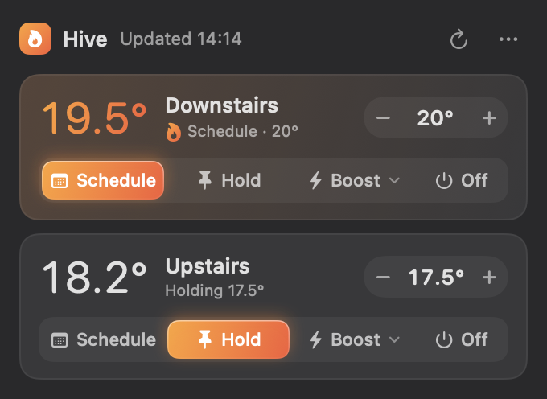
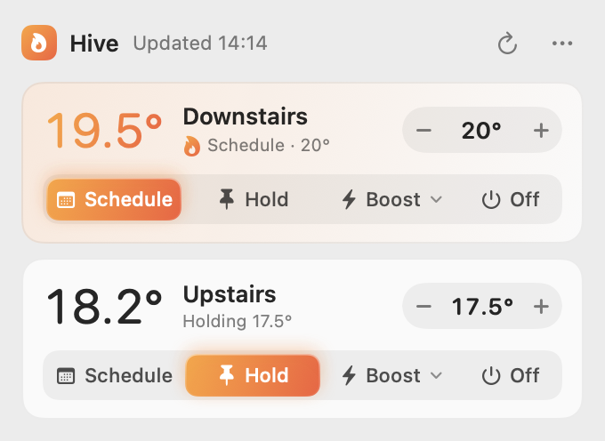

# Hive Control

Local control of Hive heating and hot water on macOS: a menu bar app, a command
line tool and a small Python API.

 

*Screenshots use sample data.* This project is not affiliated with or endorsed by
Hive or British Gas.

Uses the community-maintained `hiveheating` client, pinned to 0.4.1.
Internet access and the Hive hub/cloud are required. This is not an official
Hive developer API; upstream changes can require client updates. Radiator
valves and other Hive accessories are not supported by this particular client.

## Login and status

From this folder:

```sh
./hive login --gui
./hive status
```

Login opens local Mac dialogs for the **account owner's** email/password and
SMS code if requested. It registers a trusted device named `Hive Control (Mac)`.
The password, refresh token and trusted-device credentials are stored together
in macOS Keychain under service `local.hive-control`, account `default`.
They are not stored in this project or printed. Status prints JSON containing
product IDs, names, current/target temperatures, mode and online status.

The command refreshes tokens automatically. If login is revoked, rerun login.
For removal, delete that Keychain item using Keychain Access; remove the trusted
device in your Hive account if you also want to revoke its account-side access.

## Controls

Name a product as `./hive status` reports it. Where heating and hot water share a
name, as in the examples below, use `heating:NAME` or `hotwater:NAME` (or an exact
product ID). Unqualified duplicate names are rejected.
These commands send live changes, except when `--dry-run` is present.

```sh
./hive temperature 'heating:Downstairs' 20 --dry-run
./hive temperature 'heating:Downstairs' 20
./hive manual 'heating:Downstairs' 20
./hive boost 'heating:Downstairs' --minutes 30 --temperature 21
./hive mode 'heating:Downstairs' SCHEDULE
./hive mode 'heating:Downstairs' MANUAL
./hive mode 'heating:Downstairs' OFF
./hive boost 'hotwater:Downstairs' --minutes 30
```

Changing the target does not separately change the operating mode. Use a timed
boost for an explicit temporary heating request. `SCHEDULE` restores scheduled
operation and ends a boost. For hot water, `MANUAL` means on. The local interface
allows 5–32 °C and boosts of 1–360 minutes; these are interface limits, and Hive
may impose additional device limits. It rejects unknown units, ambiguous names
and offline products before sending a control request.

The `manual` command sets both MANUAL mode and the requested temperature in one
request. It uses the pinned client's internal `_set_state` method; review this
call when upgrading the client. A manual hold lasts until you change the mode.

## macOS menu bar app

Build it with `./macos/build.sh` (Apple Silicon, Xcode command line tools) and copy
`build/Hive Control.app` to `~/Applications/`. Open it and click its menu bar item.
It has no Dock icon. The menu bar shows each heating zone's initial and measured
temperature as two small rows, `D: 19.5°` over `U: 18.2°`, coloured on
a scale from blue (18 °C and below) through the normal text colour (20 °C) to
orange (22 °C and above). An offline zone shows a dash; before the first successful
read the item is a thermometer icon.

The two-row form is used on every display, so the item keeps one width and stays
narrow enough to sit beside a MacBook notch in most menu bars. macOS hides any item
that would run under the notch, without warning; if that happens, remove or reorder
other menu bar icons. Only one copy runs at a time: a newly opened copy quits any
older one, so the build folder's app and the installed app cannot both take a menu
bar slot. Each heating zone is one compact
card: the current temperature, a **− / +** stepper for a draft temperature, and a
mode strip of **Schedule**, **Hold**, **Boost** (30 minutes, 1 hour or 2 hours) and
**Off**, with the mode Hive reports highlighted. Changing the stepper alone sends no
heating command; **Hold** lights up until the draft is applied with Hold or Boost.
An Off zone starts its draft at 20 °C rather than its frost-protection target.
The **⋯** menu includes **Launch at login**, **Reconnect to Hive…** and **Quit**.
Launch at login is optional and is not enabled by the installer.

The UI is native SwiftUI/AppKit, with the existing Python client and Keychain
connection handling cloud calls. Reads refresh every minute while the panel is
open and every five minutes while closed. Network work runs off the UI thread;
mode buttons ignore clicks during a request. Failed reads keep the last known values
with an error and the time of the last successful update. A mode change moves
the strip's highlight at once and shows no message; the highlight pulses until
Hive's readback confirms it. If the readback does not match yet, the app reads
again after four seconds and then shows whatever Hive reports. Failed requests
still show an error and return the highlight to the reported mode.

Keep this project folder and its `.venv`: the installed app points at that Python
runtime. The app bundles a copy of `hive_control.py`; rebuild it after backend
changes. It is a local Apple Silicon build, ad-hoc signed, not a notarized
redistributable. Rebuild with `./macos/build.sh`, quit the running app, then copy
`build/Hive Control.app` to `~/Applications/`. Source: `macos/HiveMenu.swift`.

Each control result includes the request and a fresh cloud readback. Cloud
acceptance/readback does not independently prove the physical boiler has acted.
A failed readback is reported separately; check `status` before repeating a write.

## Python API

Run scripts using this project's `.venv/bin/python`. Use `connected()` and
`command()` to share the Keychain login and validation:

```python
import asyncio
from hive_control import connected, command, snapshot

async def main():
    async with connected() as hive:
        print(snapshot(await hive.get_nodes()))
        preview = await command(
            hive, "heating:Downstairs", "boost",
            minutes=30, temperature=21, dry_run=True,
        )
        print(preview)
        # Set dry_run=False (or omit it) to send this request.

asyncio.run(main())
```

`connected()` also yields the underlying `hiveheating.Hive` object for advanced
API calls. Calls made directly on that object bypass this wrapper's validation.
Keep credentials and library debug logging out of shared logs.

The cloud client reads `GET https://beekeeper.hivehome.com/1.0/nodes/all` and
writes `POST /1.0/nodes/{type}/{id}`. Its authentication handles Cognito SRP,
SMS verification, trusted devices and token refresh, so callers need not
manually copy tokens into curl. No local HTTP server or public endpoint is installed.

## Use from a coding agent

Ask for a reading, a specific temperature, a timed boost or restoration of the
schedule. An agent such as Codex or Claude Code can execute `./hive` directly.
Read status first to identify products, use only the requested device/settings,
and inspect the returned state. Do not change heating as a connection test.

## Installation and checks

Python 3.13 or later:

```sh
python3 -m venv .venv
.venv/bin/python -m pip install -r requirements.txt
.venv/bin/python -m unittest -v
./hive status --demo
```

Demo uses the dependency's bundled synthetic fixture. Tests mock all writes;
neither exercises the home's actual controls.

Sources checked 16 November 2026:
- https://pypi.org/project/hiveheating/0.4.1/
- https://github.com/tomwilkie/hiveheating
- https://www.home-assistant.io/integrations/hive/

## Licence

MIT; see [LICENSE](LICENSE). The `hiveheating` client it depends on has its own licence.
